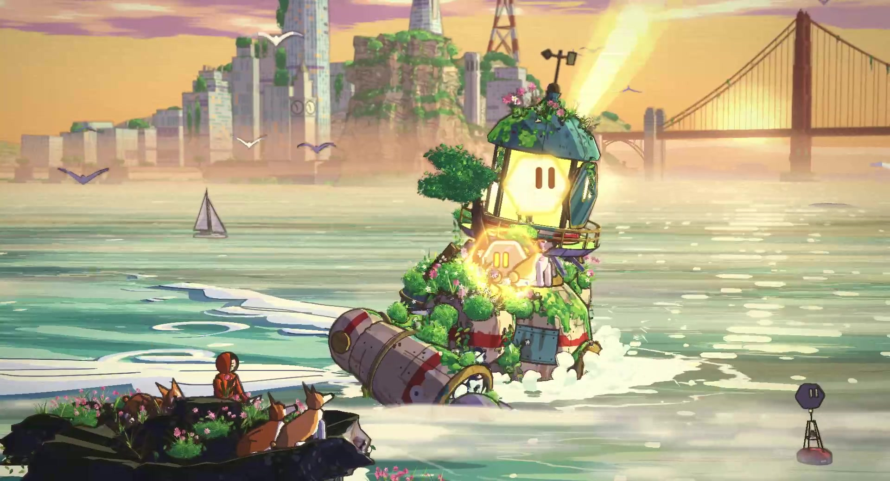

# tide-keeper-sf

*A frame from the film.*

The Tide Keeper of San Francisco: a short film (1935 frames, 80.625 s, 24 fps, 1920x1040) as one self-contained HTML file that renders itself to MP4 in Chrome.

The picture is drawn by code (three.js) and the score is synthesised by code, so the file has no images, fonts, models or audio, and fetches nothing. To render it, download `tide-keeper-sf.html`, open it in Chrome or Edge on a computer with a GPU, press "Render MP4" and keep the tab in front (about a minute on an Apple M5 Max; the file is about 80 MB). The comment at the top of the file lists the options (`?scale=0.5`, `?mbps=3`, `?from=..&to=..`) and how to drive it from a script.

## License

[MIT](LICENSE), Copyright (c) 2026 Reason Machines. The same license is in the comment at the top of `tide-keeper-sf.html`. three.js and mp4-muxer, packed into that file, keep their own MIT licenses beside them.
